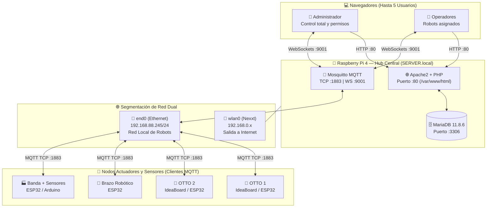

# 🤖 Robot Hub Central — Infraestructura Backend (Raspberry Pi 4)


-A81D33?style=for-the-badge&logo=debian&logoColor=white)


Servidor centralizado (**Hub**) sobre Linux para controlar y orquestar en tiempo real múltiples plataformas robóticas heterogéneas: **2 robots OTTO** (IdeaBoard/ESP32), **1 brazo robótico**, **1 banda transportadora con sensores** y nodos auxiliares (ESP32 / Arduino).

La arquitectura descarga la interfaz web, la autenticación de hasta **5 usuarios con roles** (*Administrador* y *Operadores*) y el almacenamiento de rutinas hacia la Raspberry Pi 4, permitiendo que los microcontroladores operen como clientes MQTT ligeros y estables sin saturación de memoria RAM.

---

## 📑 Tabla de Contenidos

- [Arquitectura del Sistema](#-arquitectura-del-sistema)
- [Hardware y Servicios Activos](#-hardware-y-servicios-activos)
- [Configuración de Red Dual](#-configuración-de-red-dual)
- [Configuración del Broker MQTT (Mosquitto)](#-configuración-del-broker-mqtt-mosquitto)
- [Estándar de Tópicos MQTT](#-estándar-de-tópicos-mqtt)
- [Modelo de Datos Proyectado (MariaDB)](#-modelo-de-datos-proyectado-mariadb)
- [Guía de Mantenimiento y Diagnóstico](#-guía-de-mantenimiento-y-diagnóstico)
- [Roadmap del Proyecto](#-roadmap-del-proyecto)

---

## 🏗️ Arquitectura del Sistema



---

## 💻 Hardware y Servicios Activos

| Componente | Especificación |
| :--- | :--- |
| **Servidor** | Raspberry Pi 4 (ARM64) |
| **Sistema Operativo** | Raspberry Pi OS (Debian Trixie `arm64`) |
| **Hostname mDNS** | `SERVER.local` (mediante `avahi-daemon`) |
| **Directorio Web** | `/var/www/html` |

### Servicios del Backend (`systemd`)

| Servicio | Función en el Hub | Estado |
| :--- | :--- | :---: |
| `apache2.service` | Servidor HTTP para el panel web y lógica PHP | 🟢 Activo |
| `mariadb.service` | Motor de base de datos relacional (`v11.8.6`) | 🟢 Activo |
| `mosquitto.service` | Broker de mensajería MQTT (TCP + WebSockets) | 🟢 Activo |
| `NetworkManager.service` | Gestión de interfaces de red dual (`end0` + `wlan0`) | 🟢 Activo |
| `avahi-daemon.service` | Resolución de nombres en red local (`.local`) | 🟢 Activo |
| `ssh.service` | Administración remota por consola | 🟢 Activo |

---

## 🌐 Configuración de Red Dual

La Raspberry Pi utiliza **dos interfaces independientes** para separar el tráfico en tiempo real de los robots del acceso a internet:

| Interfaz | Perfil NetworkManager | Subred / IP | Gateway | Propósito |
| :--- | :--- | :--- | :--- | :--- |
| **`end0`** (Ethernet) | `netplan-eth0` | `192.168.88.245/24` (Estática) | *Ninguno* (`never-default`) | Red aislada y dedicada para robots y estaciones locales |
| **`wlan0`** (Wi-Fi) | `netplan-wlan0-Nexxt` | `192.168.0.x/24` (SSID: `Nexxt`) | `192.168.0.1` | Salida a internet, paquetes `apt` y administración remota |

> [!IMPORTANT]
> La interfaz Ethernet `end0` está configurada **sin puerta de enlace** (`ipv4.gateway ""`) y con `ipv4.never-default yes`. Esto impide que Linux intente enrutar el tráfico de internet por la red local de los robots (métrica más baja) y garantiza internet permanente por `wlan0`.

### Comandos de restauración de red (`nmcli`)

```bash
# 1. Configurar Ethernet local de robots con IP fija (sin gateway)
sudo nmcli connection modify "netplan-eth0" \
  ipv4.method manual \
  ipv4.addresses 192.168.88.245/24 \
  ipv4.gateway "" \
  ipv4.never-default yes
sudo nmcli connection up "netplan-eth0"

# 2. Priorizar red Wi-Fi principal (Nexxt) para salida a internet
sudo nmcli connection modify "netplan-wlan0-Nexxt" \
  wifi-sec.key-mgmt wpa-psk \
  wifi-sec.psk "<WIFI_PASSWORD>" \
  connection.autoconnect yes \
  connection.autoconnect-priority 10
sudo nmcli connection up "netplan-wlan0-Nexxt"
```

---

## 📡 Configuración del Broker MQTT (Mosquitto)

- **Archivo de configuración:** `/etc/mosquitto/conf.d/hub.conf`
- **Archivo de credenciales:** `/etc/mosquitto/passwd` (permisos `640`, propietario `mosquitto:mosquitto`)
- **Usuario de servicio:** `robot_hub`

```conf
# Puerto TCP para microcontroladores (ESP32, IdeaBoard, Arduino, Python)
listener 1883
protocol mqtt

# Puerto WebSockets para el Dashboard Web (MQTT.js en navegador)
listener 9001
protocol websockets

# Seguridad obligatoria
allow_anonymous false
password_file /etc/mosquitto/passwd
```

> [!TIP]
> Para regenerar o agregar usuarios MQTT sin borrar los existentes, omite la bandera `-c`:
> `sudo mosquitto_passwd /etc/mosquitto/passwd nuevo_usuario`

---

## 📨 Estándar de Tópicos MQTT

Todos los dispositivos siguen una convención jerárquica uniforme para facilitar la escalabilidad y la asignación de permisos:

| Tópico | Dirección | Descripción / Ejemplo de Payload |
| :--- | :---: | :--- |
| `hub/<robot>/cmd` | Hub ➡️ Robot | Comandos JSON ligeros: `{"ll":87,"lf":80,"rl":90,"rf":85,"speed":500}` o `{"beep":[1000,200]}` |
| `hub/<robot>/telemetria` | Robot ➡️ Hub | Lectura de sensores: `{"dist": 14.5}` o `{"sensor_pieza": 1}` |
| `hub/<robot>/status` | Robot ➡️ Hub | Estado `online` / `offline` gestionado mediante *Last Will and Testament* (LWT) |

---

## 🗄️ Modelo de Datos Proyectado (MariaDB)

Base de datos dedicada `robot_hub` diseñada para gestionar el control individual, el modo conjunto y los permisos de hasta 5 usuarios:

| Tabla | Propósito | Campos Principales |
| :--- | :--- | :--- |
| **`usuarios`** | Credenciales y control de roles | `id`, `username`, `password_hash`, `rol` (`admin` / `operador`) |
| **`dispositivos`** | Inventario de hardware conectado | `id`, `nombre`, `tipo`, `topico_base`, `estado` |
| **`permisos_usuario`** | Matriz de asignación por operador | `usuario_id`, `dispositivo_id` |
| **`rutinas`** | Coreografías y secuencias globales | `id`, `dispositivo_id`, `nombre`, `pasos_json` |

---

## 🛠️ Guía de Mantenimiento y Diagnóstico

### 1. Verificar estado de los servicios del Hub
```bash
systemctl status apache2 mariadb mosquitto --no-pager
```

### 2. Comprobar puertos en escucha (`80`, `1883`, `9001`, `3306`)
```bash
sudo ss -tlnp | grep -E '80|1883|9001|3306'
```

### 3. Probar comunicación MQTT en tiempo real
Abre dos terminales SSH en la Raspberry Pi:

**Terminal 1 — Monitor de tráfico (Suscriptor):**
```bash
mosquitto_sub -h 192.168.88.245 -p 1883 -u robot_hub -P "<MQTT_PASSWORD>" -t "hub/#" -v
```

**Terminal 2 — Envío de comando de prueba (Publicador):**
```bash
mosquitto_pub -h 192.168.88.245 -p 1883 -u robot_hub -P "<MQTT_PASSWORD>" -t "hub/otto1/cmd" -m '{"beep":[1000,200]}'
```

### 4. Revisar logs y estado de red
```bash
# Logs del broker Mosquitto
sudo journalctl -u mosquitto -n 30 --no-pager

# Logs de errores de Apache / PHP
sudo tail -n 30 /var/log/apache2/error.log

# Estado de interfaces y tabla de enrutamiento
nmcli device status && ip route
```

---

## 📌 Roadmap del Proyecto

- [x] Infraestructura base en Raspberry Pi 4 (`Apache2`, `MariaDB 11.8.6`, `Avahi`, `SSH`).
- [x] Segmentación de red dual (`end0` estática para robots + `wlan0` para internet).
- [x] Instalación y aseguramiento de Mosquitto MQTT (`1883` TCP + `9001` WebSockets).
- [ ] Creación del esquema SQL en MariaDB (`robot_hub`) y usuarios iniciales.
- [ ] Migración de IdeaBoard (OTTO) de servidor HTTP embebido a cliente MQTT ligero.
- [ ] Desarrollo del Dashboard web con login, permisos por usuario y conexión vía WebSockets.
- [ ] Orquestador de secuencias en conjunto (Banda + Brazo + OTTOs).
